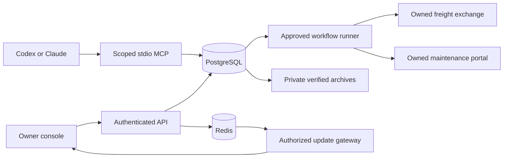

# Architecture overview

Fleetwright supervises complete browser workflows. PostgreSQL owns durable intent, authority and
outcomes; Redis accelerates dispatch and live updates; Playwright performs destination interaction.
The MCP server submits and investigates work without granting itself human approval.

## Responsibilities

| Component | Current responsibility |
|---|---|
| Core | Typed configuration, row-level tenant transactions, claim/job states, canonical contracts and fencing |
| Coordinator | Password/TOTP sessions, CSRF and roles, approvals/grants, audit, freight dispatch, workflow investigation/metrics |
| Freight worker | One Chromium with isolated watcher/claimer contexts, warm sessions and freight-specific action handling |
| Workflow worker | Separate process for approved freight and maintenance contracts, durable job/account holds and receipt reconciliation |
| Browser adapters | Generic authentication separated from freight fields, permitted owned origins, form/receipt validation |
| MCP server | Six bounded stdio tools; every call checks tenant, user, grant scope, expiry and revocation |
| Dashboard/gateway | Live operator views, owner workflow review, bounded SSE fan-out and periodic authorization rechecks |
| Owned destinations | Independent destination database and receipts; freight exchange and maintenance portal use different payloads |
| Backup CLI | Host-side Docker execution of PostgreSQL tools, archive validation, hashes, retention and fresh restore drills |

## Durable workflow protocol

Submission binds a stable action identity to tenant, account, exact inputs and the full contract
revision/hash. Reusing an identity with different content fails. Owner approval references that
fingerprint and expires by the database clock. A worker leases a job and account with a new fence,
then rechecks authorization immediately before committing `ACTING`. Only current fenced state
transitions can record results. The human approval is consumed for that execution.

Known destination rejection becomes `FAILED`. Response loss, process death or insufficient receipt
evidence becomes `UNKNOWN`. Expired pre-action leases can return to the ready queue; post-action
uncertainty cannot. Reconciliation reads destination receipts and checks the account and expected
action. Missing evidence does not establish failure. Persisted rotation prevents one old unknown
job from monopolizing reconciliation. Cancellation during uncertainty records intent and does not
claim to undo an external action. See [the workflow runbook](../operations/reliable-browser.md).

Fencing protects Fleetwright database authority; an arbitrary website does not consume that fence.
Correctness therefore also depends on the adapter's permitted action and receipt contract. Never
generalize controlled destination results into exactly-once delivery on all websites.

## Existing freight pipeline

Watchers capture bounded feed responses and publish detections. Filters/schedules select jobs;
claims and outbox rows commit together. The relay publishes to a cell stream. Warm actors lease,
act and record outcomes. The control reconciler examines uncertain bookings without blind retry.
Redis consumer groups reclaim interrupted deliveries; PostgreSQL unique constraints and fencing
remain authoritative. See [claim lifecycle](claim-lifecycle.md).

## Isolation and evidence

Tenant content tables use PostgreSQL `ENABLE` and `FORCE ROW LEVEL SECURITY`. Directory/system
lookups have narrow roles; shared infrastructure metadata is not represented as tenant content.
Target credentials and sessions use per-record envelope encryption and row-bound associated data.
Database mutations and their audit rows share a transaction. External Redis/HTTP operations persist
intent first and outcome afterward; unresolved intent remains inspectable after a crash.
Evidence exports are bounded/redacted canonical JSON with page hashes. Hashes detect changes;
they do not prove authorship. Browser artifacts may contain sensitive data and stay private.

## Scale boundaries

The freight engine has tenant-to-cell routing and Redis hash tags. The approved-workflow runner
currently enumerates tenants and processes bounded work per tenant: it is not yet assigned to
independent cells. SSE-triggered refetch traffic, database pools and workflow scheduling must be
measured and redesigned at later milestones. A single-server deployment shares its host failure
domain. Multi-zone placement, gateway fleets, sharding and regional recovery remain
[future architecture](../scaling/README.md), with explicit [decision records](../adr/README.md).

The stack is Python 3.12, FastAPI, SQLAlchemy/Alembic, PostgreSQL, Redis Streams, Playwright,
official FastMCP and Next.js/React. Lockfiles and deployment image digests define release versions.
