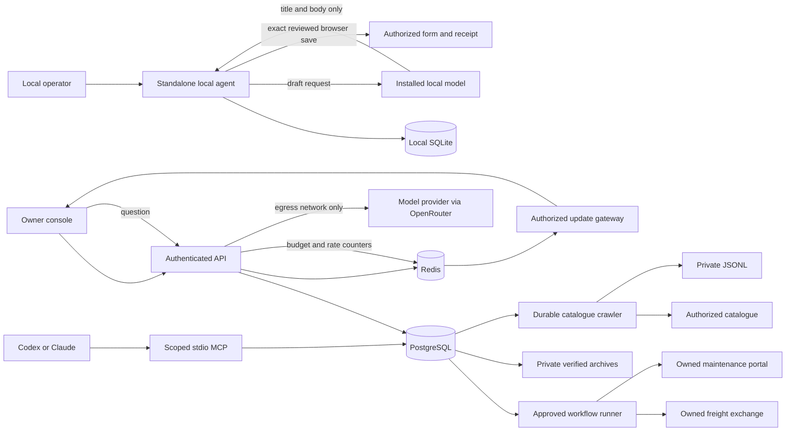
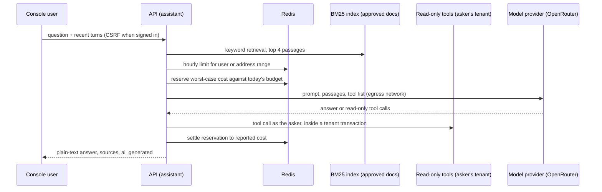

# Architecture overview

Fleetwright supervises complete browser workflows. PostgreSQL owns durable intent, authority and
outcomes; Redis accelerates dispatch and live updates; Playwright performs destination interaction.
The MCP server submits and investigates work without granting itself human approval.

## Responsibilities

| Component | Current responsibility |
|---|---|
| Core | Typed configuration, row-level tenant transactions, claim/job states, canonical contracts and fencing |
| Coordinator | Password/TOTP sessions, CSRF and roles, approvals/grants, audit, freight dispatch, workflow investigation/metrics, help assistant |
| Freight worker | One Chromium with isolated watcher/claimer contexts, warm sessions and freight-specific action handling |
| Workflow worker | Separate process for approved freight and maintenance contracts, durable job/account holds and receipt reconciliation |
| Catalogue crawler | Tenant/cell-scoped PostgreSQL frontier, pinned bounded HTTP requests, extraction/quality guards and private JSONL exports |
| Standalone local agent | SQLite/WAL, local model drafts, bounded dedicated/isolated-CDP browser contexts and exact approved form saves |
| Operational tools | Renewable observe-only collection, independent encrypted recovery and offline artifact signing |
| Browser adapters | Generic authentication separated from freight fields, permitted owned origins, form/receipt validation |
| MCP server | Six bounded stdio tools; every call checks tenant, user, grant scope, expiry and revocation |
| Dashboard/gateway | Live operator views, owner workflow review, bounded SSE fan-out and periodic authorization rechecks |
| Owned destinations | Independent destination database and receipts; freight exchange and maintenance portal use different payloads |
| Backup CLI | Host-side Docker execution of PostgreSQL tools, archive validation, hashes, retention and fresh restore drills |

## Help assistant data flow

The console help assistant is part of the API process (`/v1/assistant`, `/v1/assistant/ask`,
`/v1/assistant/feedback`). It cannot change state, so a page, document or question cannot make it act.

1. **Retrieval.** A small BM25 keyword index over 16 approved public documents
   (`config/assistant.yaml`, generated into `config/assistant-knowledge.json`; a test fails when the
   index no longer matches the documents). No embeddings or vector store.
2. **Limits before cost.** Per-user (signed in) or per-address-range (anonymous) hourly question
   limits, a per-process concurrency limit and a deployment-wide daily budget, reserved atomically in
   Redis at the worst-case price of each call and settled to the provider-reported cost.
3. **Model call.** Only the API container joins a separate `egress` network; `backend` stays internal
   and no other service gains internet access. The API calls only the configured provider endpoint and
   never fetches URLs supplied by visitors. See [ADR 0016](../adr/0016-assistant-provider-egress.md).
4. **Tools.** Eight read-only tools (overview, workers, claims, latency, filters, schedules, accounts,
   public workspace status) run as the asker in the asker's tenant through the same views and RLS as
   the console's read endpoints. No audit or user-list tools. Results are bounded and wrapped as
   untrusted data.
5. **Answer.** At most three model calls and four tool calls per step within one 25-second whole-answer
   deadline, below the edge proxy's 30-second timeout. The answer is plain text, marked
   `ai_generated`, with sources listed separately.
6. **Fallback.** When the AI is off, rate limited, busy, over budget or slow, or when the provider fails (or Redis fails for an anonymous visitor; signed-in sessions themselves need Redis),
   the asker gets the most relevant documentation passages instead (`mode: "search"`).

Nothing the asker types is stored by Fleetwright. Redis holds only the day's spend, hourly question
counts, daily counters without question text and a one-hour single-use feedback id; logs hold
metadata (mode, steps, tool names, cost, latency). See [data lifecycle](../security/data-lifecycle.md).

## Durable workflow protocol

Submission binds a stable action identity to tenant, account, exact inputs and the full contract
revision/hash. Reusing an identity with different content fails. Owner approval references that
fingerprint and expires by the database clock. A worker leases a job and account with a new fence,
then rechecks authorization immediately before committing `ACTING`. Only current fenced state
transitions can record results. The human approval is consumed for that execution.

Known destination rejection becomes `FAILED`. Response loss, process death or insufficient receipt
evidence becomes `UNKNOWN`. Expired pre-action leases can return to the ready queue; post-action
uncertainty cannot. Reconciliation reads destination receipts and checks the account and expected
action. Missing evidence does not establish failure. Persisted rotation prevents one old unknown
job from monopolizing reconciliation. Cancellation during uncertainty records intent and does not
claim to undo an external action. See [the workflow runbook](../operations/reliable-browser.md).

Fencing protects Fleetwright database authority; an arbitrary website does not consume that fence.
Correctness therefore also depends on the adapter's permitted action and receipt contract. Never
generalize controlled destination results into exactly-once delivery on all websites.

## Freight delivery and durable detections

Watchers capture bounded feed responses and persist raw detections before delivery. Filters/schedules select jobs;
claims and outbox rows commit together. The relay publishes to a cell stream. Warm actors lease,
act and record outcomes. The control reconciler examines uncertain bookings without blind retry.
Redis consumer groups reclaim interrupted deliveries; PostgreSQL unique constraints and fencing
remain authoritative. See [claim lifecycle](claim-lifecycle.md).
Raw detections remain in the PostgreSQL mailbox until their filter/claim decision commits. Tenant
moves reset unconsumed delivery under the directory lock, so unread old-cell streams and in-flight
messages are replayed using current authority. Legacy Redis-only upgrade data requires an explicit
drain; older backends cannot safely consume the new topic. See [deployment](../operations/deployment.md).

## Isolation and evidence

Tenant content tables use PostgreSQL `ENABLE` and `FORCE ROW LEVEL SECURITY`. Directory/system
lookups have narrow roles; shared infrastructure metadata is not represented as tenant content.
Target credentials and sessions use per-record envelope encryption and row-bound associated data.
Database mutations and their audit rows share a transaction. External Redis/HTTP operations persist
intent first and outcome afterward; unresolved intent remains inspectable after a crash.
Evidence exports are bounded/redacted canonical JSON with page hashes. Hashes detect changes;
they do not prove authorship. Browser artifacts may contain sensitive data and stay private.

## Scale boundaries

The freight engine has tenant-to-cell routing and Redis hash tags. The approved-workflow runner
uses bounded cell-scoped tenant pages and per-tenant turns, rechecking assignment before admission.
SSE-triggered refetch is coalesced; database pools and workflow scheduling must be
measured and redesigned at later milestones. A single-server deployment shares its host failure
domain. Multi-zone placement, gateway fleets, sharding and regional recovery remain
[future architecture](../scaling/README.md), with explicit [decision records](../adr/README.md).

The stack is Python 3.12, FastAPI, SQLAlchemy/Alembic, PostgreSQL, Redis Streams, Playwright,
official FastMCP and Next.js/React. Lockfiles and deployment image digests define release versions.

## Three separate execution authorities

The fleet and general workflow runner share PostgreSQL authority, but use distinct process/account
lifecycles. Catalogue collection uses a fenced durable frontier and an allowlisted HTTP fetch
process; it does not give operators arbitrary browser scripting. The local agent uses SQLite on
the user's computer and an installed model for typed drafting; it does not depend on fleet services.

The help assistant is a fourth, read-only path: it reads through the asker's role and tenant and
holds no execution authority. These boundaries prevent a model response, page instruction, Redis
delivery or UI refresh from becoming authority. Local edits survive polling but cannot authorize the old proposal; saving them
creates a new hash. Each uncertain action is reconciled against its destination contract.

## Operational failure domains

The host collector has administrative Docker authority solely for observe-only grant renewal;
the independent probe has neither execution nor approval access. Off-host recovery uses a separate
encryption key and proves data restoration without overwriting source databases. Those are distinct
from full-host/application recovery and measured availability.

Release identity includes committed source, immutable artifact inventory, final native app/web
image IDs and independently trusted signatures. Scan results are bound to those exact images.
Static rollback preserves compatible backends and mailbox state; backend recovery requires its
own tested compatibility procedure. See [deployment](../operations/deployment.md),
[monitoring](../operations/monitoring.md) and [recovery](../operations/recovery.md).
