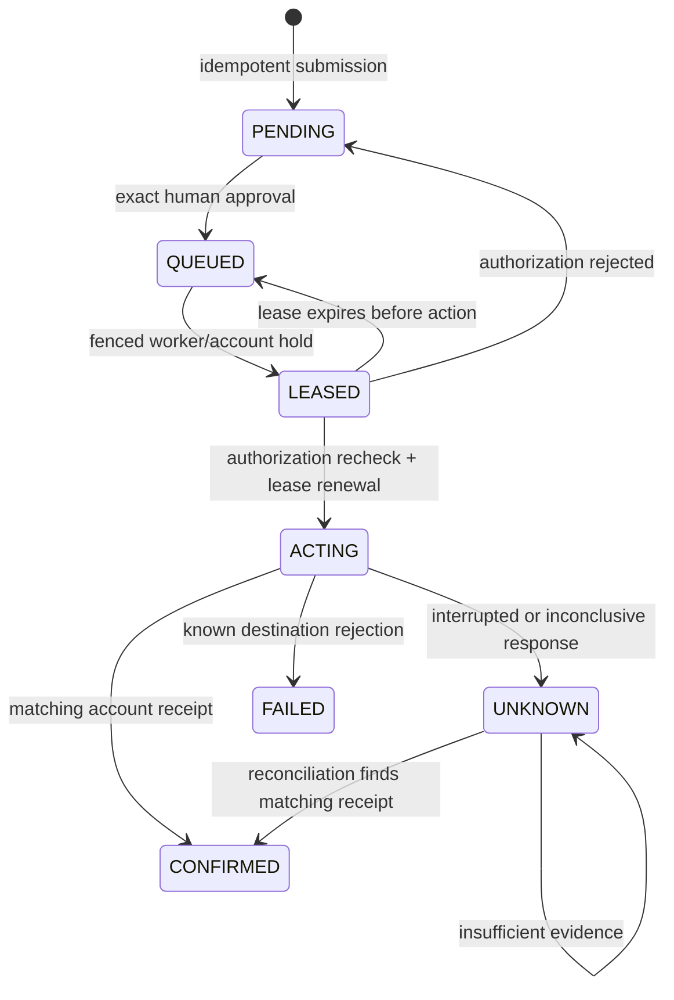

# Reliable browser workflows

Fleetwright coordinates complete authorized workflows around its existing freight engine.
The second owned workflow creates a maintenance request on the owned freight board's `/portal` page.
Both use the same destination account vault but have different forms, payloads and receipt checks.
Neither requires a paid model API or a third-party account.

Authentication contracts are separate from freight contracts: a service-only target can supply
login and identity checks without inventing freight endpoints. Legacy freight workers filter
their account acquisition to freight-capable targets. These adapters remain restricted to the
configured owned origin; this is not arbitrary-site browser execution.

## Start and authorize

1. Install the locked workspace (`uv sync --frozen`) and Playwright Chromium. Start the local
   data stack, owned freight board and coordinator using the existing development instructions.
2. Run `python -m fw_coordinator.migrate`. Apply every current migration; workflow, crawler, pacing and durable-detection changes have
   separate compatibility requirements described in [deployment](deployment.md).
3. Sign in as a real owner with password and TOTP. The shared workspace account cannot approve
   or issue access grants. `POST /v1/workflow-grants` accepts `{"scopes":["observe","execute"]}`
   with the authenticated cookie and session CSRF header. Use observation alone for investigation.
4. Save the returned tenant ID and short-lived token as `FW_MCP__TENANT_ID` and
   `FW_MCP__ACCESS_TOKEN` in the gitignored local environment, and record the actual recovery
   values in the already-ignored credentials file. Never put tokens into CLI arguments,
   client JSON/TOML, prompts, evidence, or source control. A grant is limited by
   `FW_WORKFLOWS__GRANT_TTL_S`; revocation is immediate on the next tool call.
5. Configure a stdio client, then run `python -m fw_worker.workflows` separately. The MCP server
   submits durable proposals; the supervised worker performs approved browser actions.

The owner API also supports `DELETE /v1/workflow-grants/{grant_id}` and
`DELETE /v1/workflows/jobs/{job_id}/approval`. All mutations require CSRF. The API contract is
generated in `contracts/openapi.yaml`.

## Claude and Codex

Run each server in the workspace directory so typed settings load its private `.env`. Use the
workspace's Python executable, not an unrelated global interpreter. On Windows select the
virtual environment under `Scripts`; on Linux select the executable under `bin`.

Codex host/project configuration:

```toml
[mcp_servers.fleetwright]
command = "python"
args = ["-m", "fw_mcp.server"]
required = true
env_vars = ["FW_MCP__TENANT_ID", "FW_MCP__ACCESS_TOKEN"]
```

Claude project configuration:

```json
{"mcpServers":{"fleetwright":{"type":"stdio","command":"python","args":["-m","fw_mcp.server"]}}}
```

`python` above must resolve to the activated workspace environment. Alternatively set `command`
to that environment's executable and configure the server working directory in the client.
Client configuration contains no secret values. Use the current client's installed model and
subscription settings; do not silently fall back to paid APIs.

Ask the client to list contracts, then submit a stable action identity, workflow ID, permitted
account ID and exactly the required inputs. `workflow_contracts` returns field constraints.
Reuse the same identity only for the same action. Changing input under an existing identity is
rejected. Missing or disabled accounts are denied.

Official setup references: [Codex MCP](https://developers.openai.com/codex/mcp),
[Claude MCP](https://code.claude.com/docs/en/mcp), [MCP tools specification](https://modelcontextprotocol.io/specification/2025-11-25/server/tools).

## Human review and outcome

Open **Console → Browser workflows**, refresh, and review a proposal. The screen shows the
destination account, exact inputs and action fingerprint. An owner must check the review box
before approving. An operator may inspect and request cancellation but cannot approve.
The fingerprint includes tenant, account, full input and complete contract revision/hash.
Set-valued contract fields are sorted before hashing, so independent coordinator and worker
processes compute the same identity. An eight-seed subprocess regression verifies this boundary.
Workers recheck approval, grant, current roles, account state and DB-clock lease immediately
before committing ACTING. Changed, expired, revoked or already-consumed approvals cannot act.



Cancellation before ACTING safely terminates the job. Cancellation during ACTING or UNKNOWN
records intent without claiming the destination action was undone. A worker death after ACTING
becomes UNKNOWN on lease expiry. UNKNOWN is never selected for another click. Fair, persisted
reconciliation rotates through old and new unknown jobs without changing their outcome age.
Missing receipts are inconclusive on these two destinations; they do not authorize a retry.

Expired approval on a queued job prevents execution. Cancel it and create a separately reviewed
proposal if the pre-action state is known; never use this procedure for UNKNOWN work.
An unavailable/expired destination session can leave a job UNKNOWN for operator investigation.
No exactly-once promise is made for arbitrary websites or destinations without verifiable receipts.

## Evidence and monitoring

Inspect a job and download its evidence in the console, or call `export_evidence`. Follow
`next_cursor` to retrieve later pages. Job listing is also paginated. Exports contain bounded
state transitions, fences, safe status/reason codes and receipt hashes, excluding credentials,
raw page HTML, cookies and arbitrary payloads. Each page has a SHA-256 hash over canonical JSON:
this detects content changes; it is not a signature or proof of who authored an export.

Authenticated operators can read `/v1/workflows/health`. Prometheus-compatible metrics at
`/v1/workflows/metrics` require an observation bearer grant and `X-Fleetwright-Tenant` header.
They report state counts, freight unknowns, pending outbox rows and alert counts. Old UNKNOWN
outcomes and stalled queued work have actionable alerts. Thresholds and operational bounds live
in typed workflow settings; operator messages and workflow definitions live in validated YAML.
Do not expose the metrics endpoint anonymously or include grant tokens in scrape logs.

Console database mutations and audit records share a transaction. External Redis/HTTP actions
record intent before action and outcome afterward, leaving visible unresolved intent on a crash.
Live streams recheck session authorization, including while idle, at the configured
`FW_GATEWAY__REVOCATION_CHECK_S` interval.

## Backup and restore

Configure `FW_BACKUP__*` through the typed settings and private environment. The host-side
backup command uses the existing Docker CLI and database container, with credentials retained
inside the database environment. `python -m fw_coordinator.backup create` writes custom-format
PostgreSQL archives, verifies their contents and records hashes. A failed backup does not remove
the last good backup. `loop` repeats at the configured interval and keeps the configured number
of completed backups; supervise it using the host's service manager and a protected backup location.

`python -m fw_coordinator.backup drill <backup-folder>` verifies hashes before restoring into
new uniquely named databases ending in `_restore_test`. It refuses existing targets and never
drops development or production databases. Database archives do not contain cluster roles:
bootstrap the repository's role setup first when restoring onto a new cluster, using private
current passwords. Protect archives as secrets and copy them to an independently protected
destination using the operator's approved backup policy.

The automated drill restores into a fresh network-isolated cluster and checks the approved job,
approval, events and audit. That is stronger evidence than counting tables in the source cluster.
The readiness probe waits for loopback TCP: the official image temporarily accepts Unix-socket
connections during initialization before shutting down that server. A delayed-initialization
regression verifies the final server is ready before one-time role bootstrap and restoration.
The [13 October release](../releases/2026-10-13.md) also verifies the protected production
scheduler, current-release process directory and archive/source integrity. These checks do not
establish off-site backup retention or full-host recovery.

## Verification

The historical reliable-browser extension met 14/14 acceptance criteria for the owner-adjusted scope:
Claude's actual client run is explicitly deferred; Codex's actual run passed for both workflows.

| Gate | Verified result |
|---|---|
| Backend behavior | Final regression run:147passed; unchanged contention benchmark separately passed in205.19s (previous full147-case run:546.13s), including the unchanged 200-worker/10,000-job contention benchmark and corrected fresh-cluster restore regression |
| Python lint / formatting / types | Ruff clean, 160 files formatted; mypy clean on 66 source files |
| Dashboard | ESLint, TypeScript and production build passed |
| Packaging / configuration | All eight Python wheel/sdist builds and Compose configuration passed; settings/config regressions passed |
| Security | Bandit medium+ clean; Gitleaks history and public working snapshot clean; Semgrep117rules/276targets, zero findings/errors |
| Dependency audit | Patched MCP SDK 1.28.1: Python audit clean; npm production audit clean. Full npm audit retains the development-only advisory described below |
| Real workflows | Freight and maintenance portal, interrupted acknowledgement, OS-killed worker after acceptance, receipt reconciliation, owner approval and evidence download passed |
| Operations | Idle-stream revocation, authenticated metrics, scheduled backup, corrupt-archive refusal and isolated fresh-cluster restoration passed |
| Client / independent review | Actual Codex submission/result/export passed; fresh-context review approved after all reported defects were fixed |

An earlier full run timed out in the legacy load benchmark before its final assertions. The
unchanged isolated rerun passed; the original 900-second deadline and coverage were preserved.
The timeout's root cause was not conclusively established. Deployment is verified separately in
the [release evidence](../releases/2026-10-13.md); representative authenticated fleet capacity remains unproven.

Full npm audit is **not clean**: the development-only Next ESLint dependency chain includes
`braces` 3.0.3, affected by [GHSA-vfj7-8cjw-p6xm](https://github.com/advisories/GHSA-vfj7-8cjw-p6xm).
The advisory and npm registry currently provide no patched release. Independent review found
the identified call handles repository `settings.next.rootDir` patterns, which this project does
not configure, and found no application runtime import. The finding is retained, with no audit
suppression or framework downgrade. Reassess when a fix appears or lint tooling accepts untrusted
patterns. This is an explicit limitation of local acceptance.

Run `python tools/dev/run_tests.py -q` against isolated test databases. Build the dashboard before
the console browser gate. The harness serializes runs so one cannot reset another's destination.
The tests cover worker contention, stale fences, killed processes after acceptance, response loss,
changed/expired/replayed approval, tenant isolation, immediate revocation, bounded redaction,
atomic audit, fair recovery and fresh-cluster restoration. The separate private Codex verification
script is an explicit manual subscription check, not a CI test or paid API fallback.

Claude's live verification is deferred at the owner's request because its subscription is off.
Keep client setup and transport verification separate from claims about an actual model-driven run.

### Configuration and secret audit

The final working-source and Git-history scans found no real secrets. Private credentials,
environment files, memory and browser/backup artifacts are ignored and absent from tracked
history. Typed settings and both environment templates cover the added execution, approval,
grant, pagination, reconciliation, stream-revocation and backup bounds. Automated configuration
regressions reject provider URLs, model IDs and obvious secret patterns in backend source.

Workflow descriptions, selectors, paths, input constraints, destination statuses, server
instructions and operator messages live in validated YAML. Deployment URLs, timeouts, storage,
credentials and operational limits live at the settings boundary. Stable API routes, state/scope
names, SQL identifiers, cryptographic primitives and fixed input/evidence safety caps remain
protocol definitions; changing a destination workflow requires configuration rather than editing
the execution state machine.

## Account pools in the release

The seed provisions a dedicated `workflow` account group alongside the four freight accounts.
`FW_WORKER__RESERVED_ACCOUNT_GROUPS` excludes that group from long-lived freight slot acquisition.
Choose the approved-workflow account when submitting jobs; accounts occupied by freight slots remain
unavailable until released. This prevents the two supervised workers from monopolizing each other's
capacity. Keep reserved groups aligned with the seed configuration.

## Current browser recovery and readiness

The 14 October release supervises the Chromium connection with a bounded read-only protocol
roundtrip and disconnect callback. Driver/browser loss triggers resource drain and process exit
for the existing supervisor. Only connected, ready slots report running; starting slots remain stale.
The typed heartbeat interval and action timeout own the probe cadence/deadline. The CDP method
name is fixed protocol syntax. Actual child termination recovered four ready slots in one restart;
strict normal SIGTERM still exits 0 with all holds released. Public bookings and both approved
workflows passed. See the [current release record](../releases/2026-10-14.md).

## Historical 13 October completion verification and lifecycle

The final completion regression passed 274 tests with six expected skips in 762.41 seconds;
all 435 source/tool hashes remained unchanged. Exact rc4 release rehearsal
includes both real MCP workflows, owner review/evidence, crawler and responsive console flows.
Separate installed-model local-agent proof and 50/70-context owned-fixture hours broaden the evidence;
they do not establish arbitrary destination correctness or authenticated fleet capacity.

The final rc4 rehearsal passed actual freight drain with four stopped slots and zero held accounts,
a controlled 12-second workflow drain, and crawler SIGTERM exit 0/non-OOM with its exact container
restored. All three configured container grace periods are 60 seconds. A separate-process crawler
resumed only after natural lease expiry; static-only rollback preserved pending durable detections
and backend identities. These are exact rehearsal proofs; deployed rc4 separately passed public
MCP/UI/HTTP and running-image/artifact parity checks.

Before dependency/service replacement, gracefully stop the freight worker, workflow worker and
crawler when present. Verify all stop graces exceed application drain bounds and record successful
non-OOM exits and released holds. Keep old control available through legacy stream drain, then
stop control and take a fresh archive before migration. See [deployment](deployment.md) and
[operational runbooks](runbooks.md).

Operational collection and independent encrypted recovery now have dedicated implementations and
proof boundaries; use [monitoring](monitoring.md) and [recovery](recovery.md) instead of treating a
local scheduled archive as complete host-loss protection. Final installation and live evidence
belong in the [release record](../releases/2026-10-13.md).
