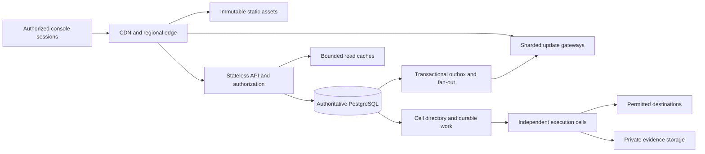

# Future architecture for 1M+ connected console users

This is a proposed architecture and acceptance plan. The current single-host release does not
implement or demonstrate this topology. The target is one million or more simultaneous authorized
console sessions across tenants; browser execution is a separate, permission-constrained service.
The [capacity model](capacity-model.md) supplies scenario arithmetic, and the
[verification record](verification-2026-10-13.md) records the smaller measured workloads.

## Workload contract and isolation

Every promotion test must declare active tenants, users per tenant, connection count, request
mix, payload sizes, mutation rate, invalidation rate, destination-action rate and duration.
Include an idle-connected population and a smaller active population; socket count alone
does not measure useful work. Test a highly active tenant alongside many small tenants.
Report invalid credentials, prohibited actions and agreed quota excess separately from eligible
service failures rather than hiding rejection traffic.

The diagram describes logical boundaries; it does not imply every service needs a separate
cluster. Start with measured bottlenecks and keep tenant/action authority explicit when splitting
services. Connection routing, data placement and execution-cell placement are separate decisions.

## Static delivery and edge

Serve immutable, content-addressed assets through a CDN with versioned release manifests and exact
CSP script hashes. Keep the release entry point, cache invalidation and rollback coherent so a
client does not mix incompatible assets and contracts. Never cache private API responses as public
content. Define cache keys, authorization handling, headers, maximum age and invalidation ownership
before enabling a cache on a route.

Use edge limits and regional routing without treating an address prefix as identity. Only
explicitly trusted proxy hops may supply client-address headers. Rate budgets must preserve
legitimate users behind shared networks and include authenticated tenant/account limits.
Edge protection does not replace API authorization or database RLS.

## API, identity and database pools

Scale stateless API replicas independently of connected users. Enforce route deadlines, bounded
pagination/body sizes, bounded hashing, per-tenant admission and finite concurrency before requests
exhaust pools. Return explicit overload responses with retry guidance and record them in the
eligible-traffic SLI. Restrict costly audit/export paths independently from interactive approval
and investigation paths so one tenant cannot consume the whole service budget.

Budget database connections across APIs, gateways, control processes, crawlers, workers, migrations
and operations, including temporary rollout replicas. Connection count follows configured pools
and active transactions, not open SSE sockets. A transaction pooler requires verification of
transaction-local tenant context, prepared statements and driver behavior; no tenant context may
survive for another request. Gateways must release transactions between authority checks rather
than holding one per connection.

Keep current approval, grant revocation, account holds, claim fences and action transitions on the
authoritative writer. Replicas can serve appropriately stale investigation/history queries; they
must not decide whether a changed or revoked action may execute. Measure replication lag and
identify views that expose it. Build indexes from real tenant predicates/query plans; partition
large histories with explicit retention before introducing database sharding.

A later tenant-sharded data plane needs a durable tenant-to-shard directory, controlled writer
ownership, versioned routing and a migration protocol. Cross-shard reports and global uniqueness
need explicit designs. A moving tenant cannot have two independent authoritative writers.

## Cache and update fan-out

Cache bounded tenant-scoped projections with role-aware keys and documented staleness. Invalidation
must follow committed changes; never publish an uncommitted proposal as confirmed. Avoid unlimited
per-session snapshots or high-cardinality keys. A cold cache or cache outage must shed/reduce work
within the database budget rather than bypassing protection and sending every client to the writer.

Shard subscription ownership by tenant/channel and distribute each committed invalidation once
to the required gateway shard. Batch redundant hints; enforce client-queue and global outbound-memory
budgets. Current SSE carries change hints and clients refetch authorized state. A future resumable
protocol must define cursor scope, retention, expiration and full-resynchronization behavior;
current ephemeral hints are not a durable event log.

Use randomized reconnect backoff, admission limits and bounded concurrent snapshot refreshes.
Spread retries after node loss, deployment and identity expiry. Test slow consumers and TCP
buffering separately from application-queue overflow. Disconnecting a lagging client must not
discard authoritative work, leak tenant data or create unbounded resync traffic. Revoked users
lose stream access within the configured check interval; delivered data cannot be recalled.

## Execution cells and destination budgets

Each cell has bounded workers, transport and resource budgets. Current workers already page
tenants within their assigned cell, limit jobs per tenant turn, enforce account group eligibility
and DB-clock action spacing, and persist raw detections before Redis delivery. Extend these
controls with measured weighted fairness, tenant admission quotas and deployment isolation that
prevents one cell from exhausting shared database or host resources.

Scale execution from eligible queue age, destination limits and browser CPU/memory pressure.
Account exclusivity and action cooldowns remain in force during autoscaling. More workers cannot
increase a destination's permitted action rate. Isolate heavy pages, evidence capture and failed
session recovery from unrelated tenants where needed.

Use the [cell migration procedure](adding-a-cell.md) to preserve directory, queued claims and
unconsumed raw detections. Stop admission, bound drain time and allow admitted work to finish or
preserve its uncertainty. Reconcile `UNKNOWN` through receipts; never increase throughput by
blindly replaying an uncertain action.

## Zone failure and spare capacity

Place redundant APIs/gateways and data services across zones, retaining sufficient running
capacity for a zone loss. Recovery should not require immediate provisioning through an impaired
control plane. This design follows the spare-capacity principle in
[AWS static-stability guidance](https://docs.aws.amazon.com/whitepapers/latest/aws-fault-isolation-boundaries/static-stability.html).

Losing one of three equally sized zones multiplies remaining utilization by 1.5. An assumed 70%
safe failure-mode ceiling therefore limits normal aggregate utilization to 46.7%, before deployment
or maintenance reserves. Validate CPU, memory, sockets, database connections and bandwidth
separately; spare capacity in one resource does not cover another's shortage.

Validate traffic evacuation, bounded reconnects, database failover with fencing and cell recovery
during partitions. Separate regional disaster recovery from zone failover; data residency, key
availability and a single writer remain mandatory in either design.

## Promotion gates

| Gate | Required evidence before increasing a supported tier |
|---|---|
| Sustained service | An uninterrupted hour at the declared 1k, 10k, 100k or 1M+ session tier; active operations/events, percentile latencies and eligible errors |
| Tenant fairness | Skewed tenants, bounded queue age/admission, small-tenant responsiveness, no tenant-data or authority crossover |
| Connection pressure | Slow readers, queue overflow, reconnect storm, authority expiry/revocation and cursor-expiry refresh behavior |
| Data pressure | Realistic histories, RLS plans, pool exhaustion, replica lag, cache cold start/outage and retained outbox correctness |
| Execution | Representative approved workflows, destination budgets, browser resource peaks, process death and receipt recovery |
| Failure mode | Node/zone loss, rolling release, drain/rebalance and unavailable provisioning control plane within the same workload/SLO |
| Recovery | Independent encrypted archive, fresh database/key/config recovery, measured RPO/RTO and no duplicate uncertain actions |
| Commercial readiness | Current provider quotes, cost per session/tenant/action, documented limits and approved support/SLA/legal duties |

An hour establishes a bounded capacity observation, not monthly availability. Publish rejected
runs and limits alongside accepted runs. Offer a tier only after its representative workload and
failure gates pass; provisioning or a successful Terraform plan establishes neither capacity nor SLOs.
